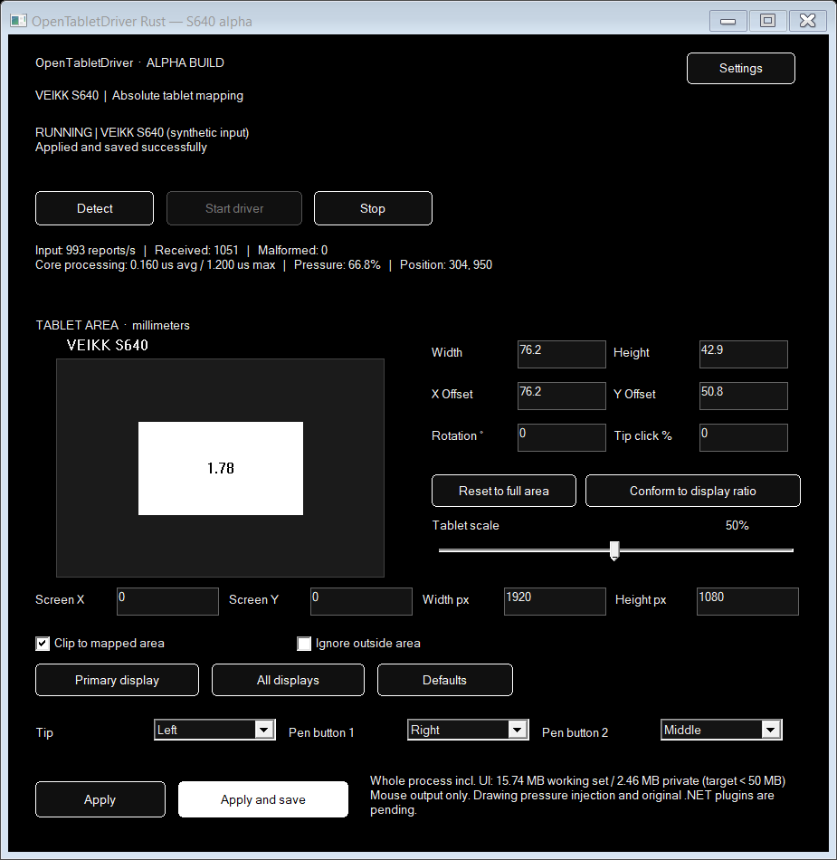

# OpenTabletDriver Rust pre-release · VEIKK S640

> **Pre-release software for Windows x64. Currently supports the VEIKK S640 only.** Other tablet models are not supported. This early Rust app is separate from the established OpenTabletDriver builds and is not a replacement for them.

This is a runnable Rust migration milestone inside the existing repository, with a total-process memory budget of **less than 50,000,000 bytes** for working set and private committed memory.

The existing C# projects are retained. The upstream S640 definition is embedded directly, and the parser is ported from its corresponding upstream C# source. No .NET runtime, WebView, browser renderer, or external HID library is required by the Rust executables.



## Run

Build with Rust 1.88+ and a Windows toolchain:

```powershell
cd rust
cargo build --release --locked
```

Open the native control panel with synthetic input:

```powershell
./target/release/otd-rust-ui.exe --simulate
```

Simulation never opens/initializes the tablet or injects pointer events. The native panel includes a live tablet-area diagram, area dimensions/center/rotation, display mapping, a 1–100% tablet-scale slider, aspect fitting, clipping/limiting, tip threshold, mouse bindings, Apply, Save, Start/Stop, status, rate, core processing time, and process memory. Tablet scale matches the largest area to the configured display aspect ratio, keeps it centered, and starts at 50%. At 1920×1080 on the S640, 50% is approximately 76.2×42.9 mm. The Settings button opens native preferences, including a persisted “Close to system tray” option with tray Open and Exit commands.

For physical tablet use, close other tablet drivers normally first to avoid competing cursor output, then launch:

```powershell
./target/release/otd-rust-ui.exe
```

The physical driver starts **stopped**. Detect only queries matching HID collections. Start sends the S640 initialization report and enables absolute mouse output; Stop releases held buttons and closes the device. Closing the panel stops the engine unless “Close to system tray” is enabled; use the tray icon’s Exit command to stop the driver in that mode. This milestone does not install startup services or change the existing driver installation.

Console diagnostics:

```powershell
New-Item -ItemType Directory -Force ./artifacts | Out-Null
./target/release/otd-rust.exe --devices
./target/release/otd-rust.exe --probe --seconds 15 --report ./artifacts/probe.json
./target/release/otd-rust.exe --headless --simulate --seconds 15
./target/release/otd-rust.exe --benchmark --iterations 1000000
```

`--probe` opens a read-only handle and observes packets without sending initialization or OS pointer events. The tablet must already be sending the supported reports, for example through the existing driver. `--run --headless` explicitly starts physical input and mouse output. Ctrl+C stops the console engine and releases held buttons. `--seconds N` gives a bounded run.

## Memory and response design

- One process with a native control panel and one input worker; no separate web renderer or console helper for the UI executable.
- Fixed native HID read buffer and stable overlapped-IO storage, allocated once per connection. Reads complete when packets arrive; the 100 ms wait bounds command/shutdown checks, not packet delivery.
- No allocation, locks, IO, or trigonometry in parser/mapping code. Affine coefficients are calculated when settings change.
- No unbounded packet queue. The input worker processes each completed report directly. UI commands use a bounded 16-entry channel.
- UI telemetry is published at most four times per second during input; it never transports every packet to the UI.
- Idle workers sleep on the command channel. Reconnection attempts are bounded and delayed one second after failure.
- Settings validate before application. Save stages beside the destination, flushes, then replaces it; a failed save leaves the prior configuration active. The original C# settings file is never overwritten.

Rust settings live under `%LOCALAPPDATA%/OpenTabletDriverRust/settings.json`. `--settings PATH` selects a separate file. This schema does not yet import .NET profiles or plugin settings.

## Verification

```powershell
cargo fmt --all --check
cargo clippy --workspace --all-targets --locked -- -D warnings
cargo test --workspace --locked
./tools/Measure-Performance.ps1 -Seconds 15
```

The measurement script runs release binaries with native UI controls rendered offscreen, samples peak working set/private memory, and fails above 50 MB. It also verifies zero allocations in the core benchmark and exercises actual native UI Apply/Stop/Start/Save notifications, invalid-area validation, and the 50% scale calculation. It does not trim the working set. Synthetic input does not test USB or `SendInput` latency.

`tools/Generate-UpstreamFixtures.ps1` compiles the actual upstream C# parser source with interface-only stubs to generate 2,048 deterministic fixtures. The Rust test compares complete decoded reports against those results. Run that generator in a fresh PowerShell process. These are generated test packets, not an exhaustive hardware corpus.

See [measurement notes](docs/PERFORMANCE.md), [migration scope](docs/MIGRATION.md), the [roadmap to broad tablet support](docs/UNIVERSAL-ROADMAP.md), and [UI contract](docs/UI-CONTRACT.md).

## Current limits

Windows x64 and VEIKK S640 only, with absolute mouse output. The pen pressure value is decoded and shown, but pressure/tilt injection into drawing applications is not implemented. Auxiliary packets are decoded but auxiliary bindings are not implemented. Relative mode, plugin loading, other tablet models, Linux/macOS, upstream settings import, installer/updater, and a polished accessible UI remain pending.

Live read-only S640 input was verified alongside the existing driver. Physical initialization and cursor/button injection are implemented but were not exercised in this session, to avoid competing with the user's active driver. Do not interpret the small prototype memory footprint as a guarantee for future feature parity or a WebView UI.

The Rust implementation and tests were generated with AI assistance. Any upstream PR must follow the repository's `AGENTS.md` disclosure requirements.
